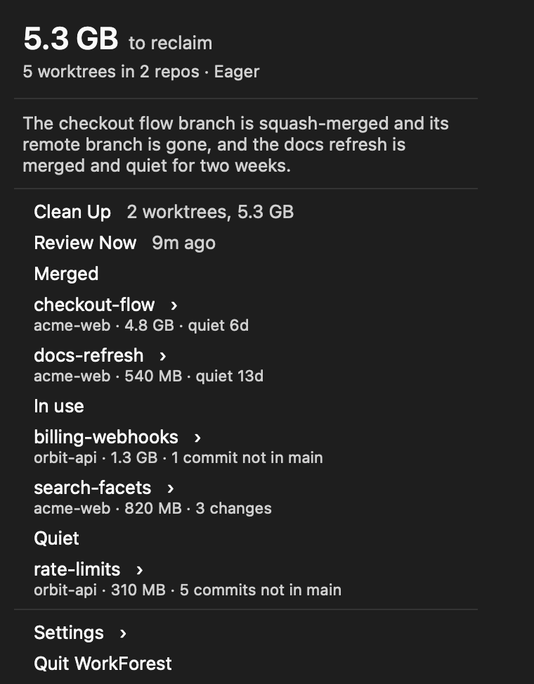
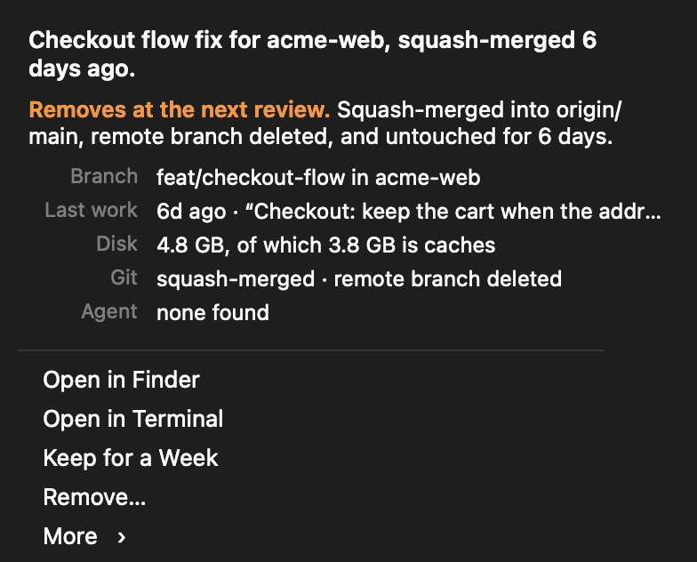

<p align="center"></p>

# WorkForest

**Every git worktree on your Mac, and whether anyone still needs it.**

WorkForest is a free menu bar app for Macs where coding agents each work in their own git worktree. The agent finishes, the branch is merged, and the worktree stays, with its node_modules and build output. WorkForest finds every worktree, works out what each one was for, whether its work is merged, and what it costs on disk. Haiku or Luna, on your own subscription, reviews them and writes a short summary. Then WorkForest removes what nobody needs, and can bring any of it back.

Free and MIT licensed · macOS 13 or newer · [Install](#install) · [How it works](docs/HOW-IT-WORKS.md) · [The review](docs/REVIEW.md)

## What it looks like

| | |
|---|---|
|  |  |
| **The menu.** How much disk you can get back, what the review found, and every worktree with its size, quiet time and state. | **A worktree.** What it is, whether it stays and why, the facts behind that, and what you can do. |

Both pictures are offscreen renders of the menu code with made-up worktrees, as [docs/RENDER.md](docs/RENDER.md) describes. The menu itself is a native macOS menu.

## What WorkForest finds out

For each worktree, read-only, with `GIT_OPTIONAL_LOCKS=0`. [Every fact](docs/HOW-IT-WORKS.md#what-it-reads)

- **Whether the work is merged.** By ancestry, by an identical tree, by `git cherry` for rebased commits, and by patch-id for squash merges. With *Check Merged Pull Requests*, also through `gh`.
- **Whether anything would be lost.** Uncommitted and untracked files, commits on no remote, detached commits that no branch holds, and stashes.
- **Whether anyone is in it.** Processes with their working folder inside, LocoHost's localhosts running there, and the Claude Code, Codex or pi session that last worked in it or named it.
- **What it costs.** Disk use, and how much of it is caches such as node_modules, .next or _build.

`workforest explain <path>` prints what the model made of a worktree, with every fact behind it, and `workforest explain .` does it for the folder you are in.

## Three modes


| Mode | What it does |
|---|---|
| **Idle** | Reviews and reports. Removes nothing by itself. *Clean Up* in the menu stays one click away. |
| **Proactive** | Removes a worktree that is merged, or whose remote branch is gone, and that nobody touched for a week. |
| **Eager**, the default | Removes every quiet worktree that can't show evidence that someone still wants it. A second model pass, the judge, looks at each one that is not clearly stale. |

*Keep for a Week* on any worktree, or `workforest keep <path>`, tells every mode to leave it alone. In Eager the burden of proof is on the worktree. Evidence is unmerged work committed in the last two weeks, an agent session that named it in the last few days, or a branch name such as `wip` or `parked`. A branch nobody touched for weeks is not evidence. No mode acts until WorkForest has watched for a day, so you see the first review before anything happens.

## Nothing is forced


- **Checked again first.** Right before a removal, WorkForest reads git status, walks the files, and looks for processes and agent sessions again. A change made a minute ago keeps the worktree.
- **git decides too.** `git worktree remove` runs without `--force`, so git refuses a worktree with changes. The branch is deleted only with `git branch -d`, which refuses unmerged work. Unmerged branches always stay.
- **Restorable.** `.env` and other ignored files that are not caches are saved first. *Recently Removed* and `workforest restore <id>` recreate the worktree at the same commit and put those files back. node_modules does not come back. Run your install again.

## Your subscription, no tools

The review runs on the login your `claude` or `codex` CLI already has, Haiku first and Luna when Haiku is out of usage. API keys in the environment are removed. The model gets facts and answers in a fixed schema. It cannot run a command or read a file, and it never sees file contents. Commit subjects and session prompts are redacted before they are sent. [What is sent](docs/REVIEW.md#what-is-sent)

## Install

```sh
curl -fsSL https://raw.githubusercontent.com/FRIKKern/workforest/main/install.sh | sh
```

It builds from source in a few seconds with Apple's Command Line Tools, so there is no Gatekeeper prompt. You get `~/Applications/WorkForest.app` and a `workforest` command in `~/.local/bin`. Add `WORKFOREST_LOGIN=1` to start it at login.

WorkForest looks in `~/Documents/GitHub`, `~/Developer`, `~/code`, `~/src`, `~/Projects`, `~/repos` and `~/dev`, three folders deep. *Edit Rules…* changes that. macOS asks once whether it may read your Documents folder. The review needs [Claude Code](https://claude.com/claude-code) or [Codex](https://github.com/openai/codex), signed in. Everything else works without them.

## For agents

```sh
workforest list --json                   # every worktree with its git state, disk use and the mode's decision
workforest explain .                     # this worktree: what it was for, whether it is merged, what keeps it
workforest auto --dry-run                # what the mode would remove now, and why
```

[Every command](docs/CLI.md)

## For developers

```sh
git clone https://github.com/FRIKKern/workforest.git && cd workforest
./build.sh && ./test.sh
```

Objective-C built with clang alone. No Xcode project, no Swift, no packages. `test.sh` runs 62 checks on a fixture repo with twelve worktrees in a temporary folder, with fake `claude` and `codex` CLIs, and never reads another repo.

| I want to … | Read this |
|---|---|
| understand what WorkForest reads and when it removes a worktree | [How it works](docs/HOW-IT-WORKS.md) |
| see what the model gets, and how the judge decides | [The review](docs/REVIEW.md) |
| change the folders it scans, protect a worktree, or name caches | [Rules file](docs/RULES.md) |
| script it or use it from an agent | [CLI](docs/CLI.md) |
| change the code | [AGENTS.md](AGENTS.md), [CHANGELOG](CHANGELOG.md) |

Part of a family. [Insomnia](https://github.com/FRIKKern/insomnia) keeps the Mac awake, [MinMacs](https://github.com/FRIKKern/minmacs) keeps the CPU and RAM for what matters, [LocoHost](https://github.com/FRIKKern/locohost) keeps the ports for what you use, and WorkForest keeps the disk for the work you still have. MIT. Made by [Frikk Jarl](https://github.com/FRIKKern).
